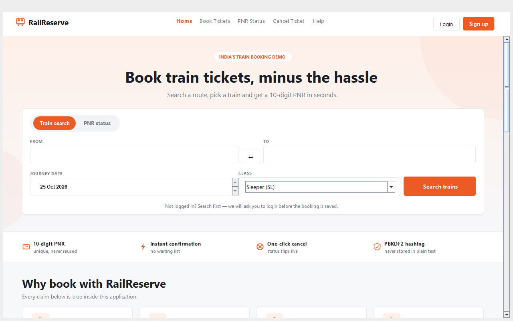
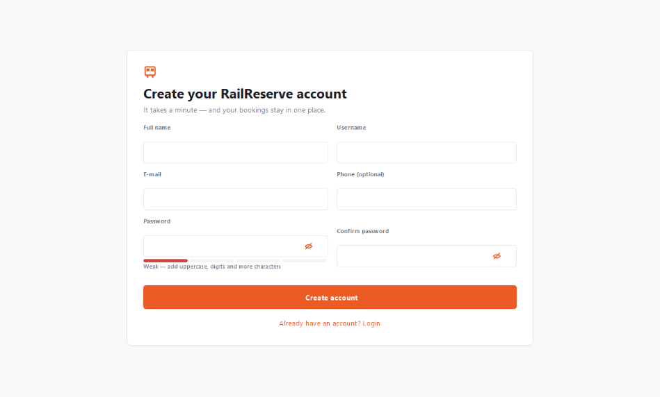
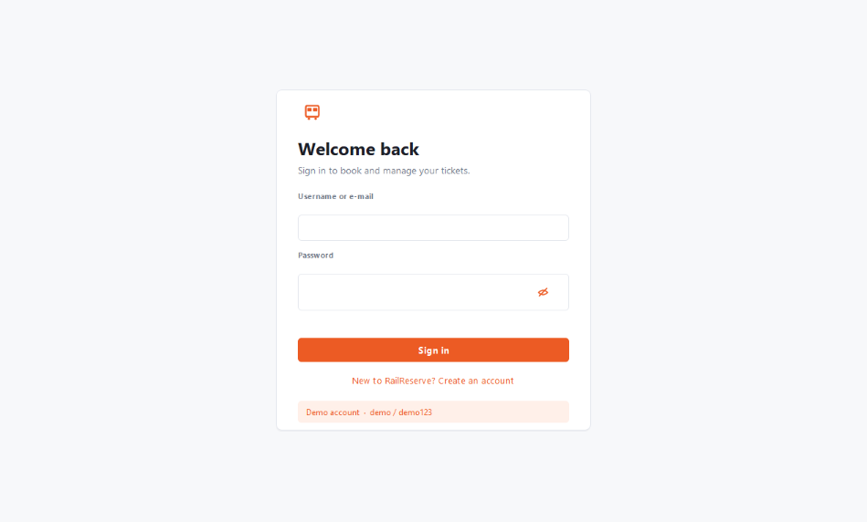
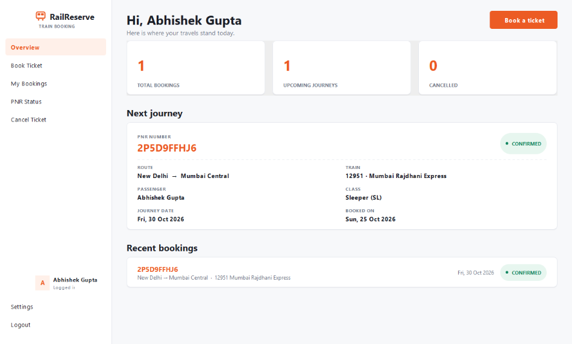
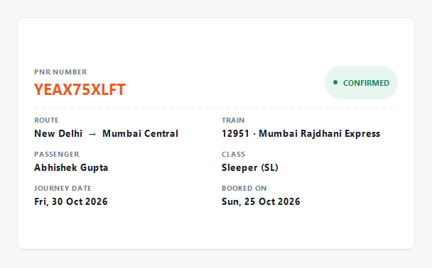
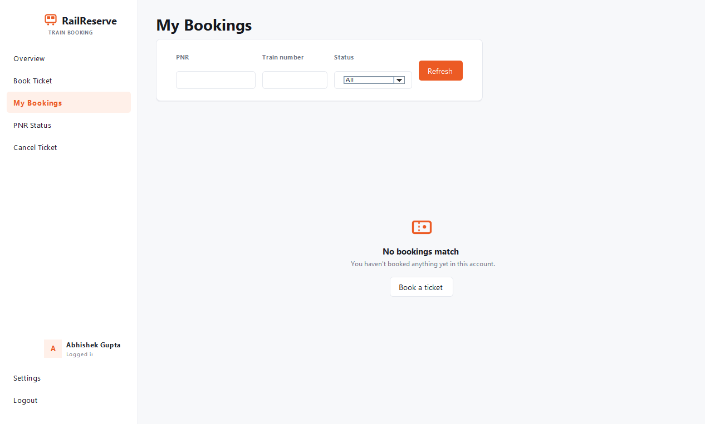
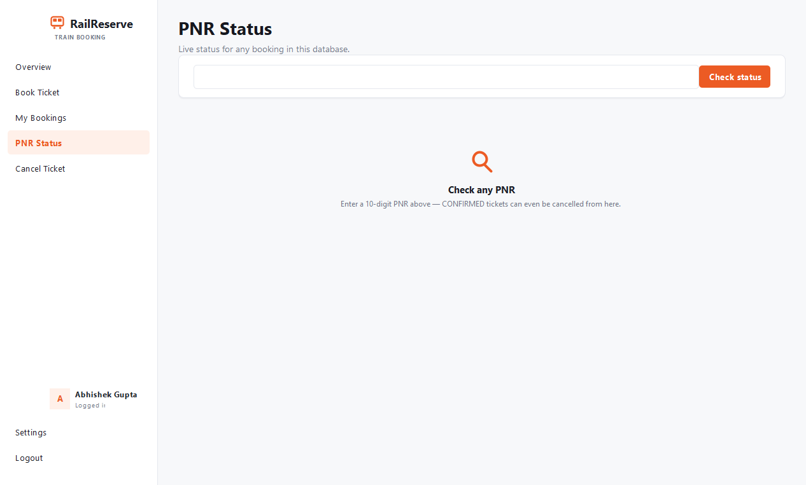
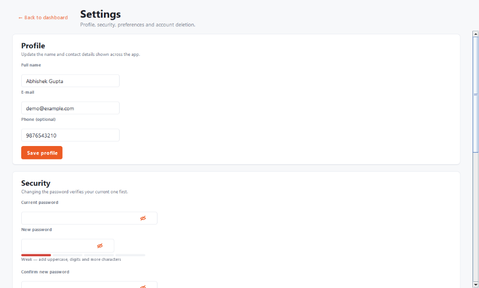

# RailReserve — Online Train Reservation System 🚆

Desktop application for **Oasis Infobyte Java Development Internship — Java Development, Task 1**.
Sign up or log in, search the landing page, book a train ticket (unique 10-digit PNR), check PNR
status, cancel a booking and manage your profile — everything persisted in PostgreSQL.

> Academic demo project. **Not affiliated with IRCTC or Indian Railways**; no real tickets are issued.

## Tech stack

Java 17+ · Maven · Java Swing (custom ixigo-style theme + reusable component set) · PostgreSQL + JDBC
(`org.postgresql:postgresql:42.7.4`) · JUnit 5

## UI design

The interface follows a clean, travel-portal design language inspired by ixigo.com:

- **Brand orange `#EC5B24`** for CTAs, active links, accents and PNR numbers (brighter variant in dark mode
- **White rounded cards** (`16px` corners, hairline borders, soft shadows) on light-grey page bands
- **Pill tabs** for the landing search widget, soft-tinted pills for chips, badges and active sidebar items
- **Light + dark palettes** resolved from a single `Theme` class; the app shell rebuilds the active
  screen on a theme flip so every widget recolors live, with no per-widget listeners
- Custom Java2D **vector icons** (train, ticket, search, shield, bolt, moon/sun toggle, eye, …)

## Repository layout — three tiers

| Folder        | Layer                  | Contents                                                                 |
|---------------|------------------------|--------------------------------------------------------------------------|
| `frontend/`   | Presentation           | Swing UI: `AppFrame` (one-window CardLayout router), landing page, Sign Up, Login, dashboard (Overview / Book / My Bookings / PNR / Cancel), Settings, `ui/components/`, `ui/theme/Theme` |
| `middleware/` | Business logic + build | `AuthService`, `AccountService`, `ReservationService`, `SignupValidator`, `LoginAttemptTracker`, `PreferencesService`, utilities, **`pom.xml`**, JUnit tests, docs |
| `backend/`    | Data access            | `dao/` (JDBC-only DAOs), `model/`, `config/DatabaseConfig`, `schema.sql`, `data.sql`, `migration_01_users.sql` |

Flow: `frontend` (Swing) → `middleware` (business rules) → `backend` (DAOs + JDBC) → PostgreSQL.
All SQL uses `PreparedStatement`; passwords are stored as PBKDF2-HMAC-SHA256 hashes and never logged.

## Screens

| # | Screen | What it does |
|---|--------|--------------|
| 1 | **Landing page** (public, at startup) | ixigo-style page: white navbar (bold wordmark + ghost links + Login/Sign-up), soft orange hero with a big rounded search card holding **pill tabs** (Train search / PNR status). Train search: From/To with swap + station autocomplete, date, class. Public quick PNR check returns a ticket card. Trust strip, "why" cards, how-it-works, popular routes (click-to-prefill), collapsible FAQ and footer. Searching while signed out saves the search and resumes it in the booking form after login. |
| 2 | **Sign Up** | Full name, username, e-mail, optional phone, password + confirm with live inline validation and a strength meter. Duplicate username/e-mail (SQLState 23505) gets a friendly message. PBKDF2 hash stored; toast + redirect to Login on success. |
| 3 | **Login** | Username **or** e-mail + password, show/hide toggle, Enter submits, loading state. Five failed attempts lock sign-in for 30 seconds with a live countdown. |
| 4 | **Dashboard** | White ixigo-style sidebar with the brand mark up top, a soft-orange pill on the active section, account chip, and post-login entries (Settings, Logout) plus a **dark-mode quick toggle** with moon/sun icon. Sections: Overview (greeting, stats with orange numerals, next-journey ticket, recent five bookings), Book Ticket (train-name auto-fill + ticket-card confirmation), My Bookings (status/PNR/train filters, status chips in the table, details dialog, cancel), PNR Status and Cancel Ticket (ticket-style cards with dashed tear lines). |
| 5 | **Settings** | Profile edit (name/e-mail/phone), change password (current verified + policy + strength meter), preferences (light/dark theme — **applies the instant you pick it**, also saved to `~/.railreserve/preferences.properties`; default class and source station pre-fill the booking form), danger zone (typed `DELETE` + password; deletes the account **and its bookings** in one transaction). |

All database work runs on `SwingWorker`s with loading states; login persists across the session
object (`UserSession`) and Logout clears it.

## Screenshots

Fresh captures of the current UI live in `docs/screenshots/` (regenerate with the offscreen
render helpers if needed):

- [x] `docs/screenshots/landing.png` — landing page with hero search widget
- [x] `docs/screenshots/signup.png` — sign-up form with strength meter / inline errors
- [x] `docs/screenshots/login.png` — login screen
- [x] `docs/screenshots/dashboard.png` — overview (stats, next journey, recent bookings)
- [x] `docs/screenshots/booking.png` — booking form with train-name auto-fill
- [x] `docs/screenshots/confirmation.png` — ticket-card confirmation after booking
- [x] `docs/screenshots/my-bookings.png` — My Bookings with filters and status chips
- [x] `docs/screenshots/pnr.png` — PNR status ticket card
- [x] `docs/screenshots/cancel.png` — cancellation confirmation / cancelled card
- [x] `docs/screenshots/settings.png` — settings (profile, security, preferences, danger zone)
- [x] `docs/screenshots/dark-mode.png` — landing page in dark mode

















## Database setup (choose one option)

### Option A — Local PostgreSQL

1. Ask PostgreSQL to create the database, then apply the schema and seed data:

   ```sql
   CREATE DATABASE railreserve;
   ```

   ```bash
   psql -U postgres -d railreserve -f backend/src/main/resources/schema.sql
   psql -U postgres -d railreserve -f backend/src/main/resources/data.sql
   ```

2. Point the app to it (defaults already match):

   ```
   DB_URL=jdbc:postgresql://localhost:5432/railreserve
   DB_USER=postgres
   DB_PASSWORD=<your local password>
   ```

### Option B — Own Supabase project (cloud)

1. Create a project on supabase.com and take the **Session pooler** host
   (`aws-0-<region>.pooler.supabase.com:5432`) — that is the IPv4-friendly port that works
   best for desktop JDBC apps.
2. Run `backend/src/main/resources/schema.sql` and `backend/src/main/resources/data.sql`
   against the Supabase database (Supabase SQL editor or psql).
3. Copy `middleware/.env.example` to `middleware/.env` and fill it in:

   ```
   DB_URL=jdbc:postgresql://aws-0-<region>.pooler.supabase.com:5432/postgres
   DB_USER=postgres.<project-ref>
   DB_PASSWORD=<your-password>
   ```

   TLS: add `?sslmode=require` to `DB_URL` explicitly if you prefer.
4. Always start the application from the `middleware/` folder (or set the env vars in the
   environment) so the `.env` file is picked up.

### Upgrading an existing database (sign-up support)

If your database was created before the frontend milestones, apply the users migration once:

```bash
psql -U postgres -d railreserve -f backend/src/main/resources/migration_01_users.sql
```

It adds `full_name`, `email` (unique, NULL-safe), `phone` and `created_at` to `users`.
The seeded demo account keeps working unchanged. `schema.sql` already contains these columns
for fresh installs.

`.env` is gitignored — server credentials never enter the repository.

## Quick start

```bash
# 1. Apply the database schema + seed data (10 trains, demo user)
psql -U postgres -d railreserve -f backend/src/main/resources/schema.sql
psql -U postgres -d railreserve -f backend/src/main/resources/data.sql

# 2. Configure the database (local default, or copy middleware/.env.example to middleware/.env)
export DB_URL=jdbc:postgresql://host:5432/postgres
export DB_USER=postgres
export DB_PASSWORD=***

# 3. Build & test (build lives in middleware/)
mvn -f middleware/pom.xml clean test     # 82 JUnit tests
mvn -f middleware/pom.xml package

# 4. Run — landing page opens; sign up, or use demo / demo123
java -jar middleware/target/railreserve-1.0.0.jar
```

> Full details (features, DB setup, environment variables, folder structure, run/testing steps):
> see **[middleware/README.md](middleware/README.md)**.

## Demo credentials (demo only!)

The seeded `demo` / `demo123` user is **for evaluation only**. You can also create your own
account through the Sign Up screen; new passwords are PBKDF2-hashed.

| Username | Password  | Purpose                    |
|----------|-----------|----------------------------|
| demo     | demo123   | **Demo only** — evaluation |

## Milestones

- [x] M1 — setup + DB connection
- [x] M2 — login + dashboard
- [x] M3 — booking flow (validation, PNR generation, duplicate-PNR retry)
- [x] M4 — PNR status + ticket cancellation
- [x] M5 — tests (36 passing), README, packaging
- [x] M6 — security audit, My Bookings tab, UI polish, 46 tests, submission docs
- [x] F1 — theme system, reusable components, one-window navigation shell
- [x] F2 — public landing page (hero search, PNR check, routes, FAQ, footer)
- [x] F3 — sign-up + users table migration (PBKDF2, strength meter)
- [x] F4 — login (username/e-mail) + session + 5-failure/30s lockout
- [x] F5 — dashboard: Overview, Book, My Bookings, PNR, Cancel (ticket cards)
- [x] F6 — settings: profile, password, live theme preferences, account deletion
- [x] F7 — polish, legacy-frame cleanup, docs, 79 tests, package + smoke run
- [x] F8 — ixigo-style redesign: brand-orange theme, white cards, pill tabs, hero landing,
      sidebar dark-mode quick toggle + instant theme in Settings (82 tests)
